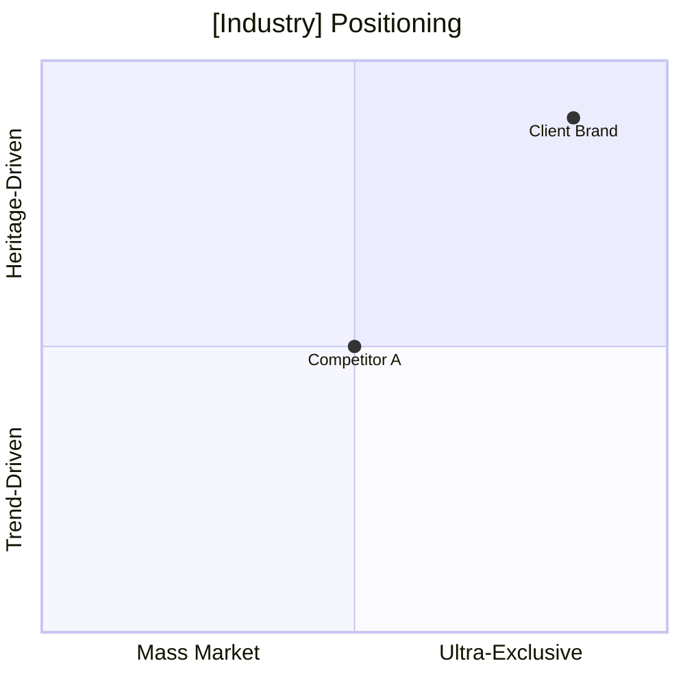
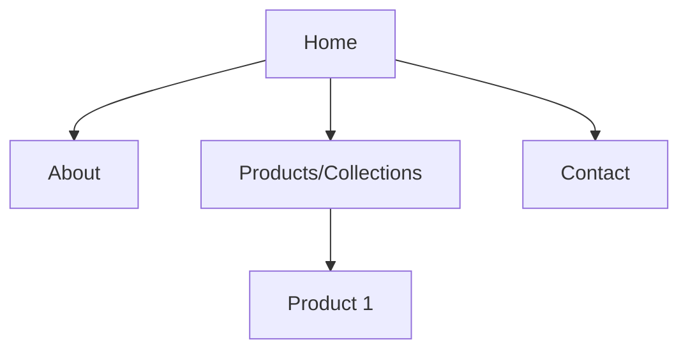
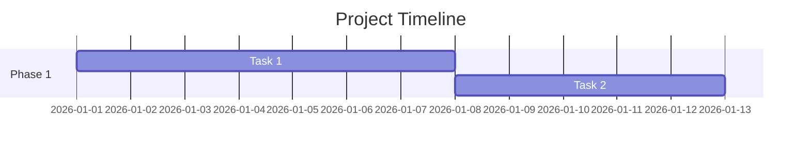

# Agency Proposal Deck Builder

## Overview
This skill codifies the proven pipeline for building comprehensive, data-driven agency proposal decks in a McKinsey-inspired format. It was developed through TSF (The Startup Folks) engagements with luxury and premium brand clients (Somi London, Jatin Kothari).

---

## Step 1: Grill-Me Interview Checklist

Before building any proposal deck, resolve ALL of the following through direct questions to the user. Do not assume answers.

### The 10 Critical Questions

| # | Question | Why It Matters |
|:---|:---|:---|
| 1 | **Current digital state** — Does the client have an existing website, social media, or any digital footprint? | Determines scope: greenfield vs. overhaul |
| 2 | **Website platform preference** — WordPress, Shopify, Custom-coded, Webflow? Present options with tradeoffs. | Impacts cost, timeline, and maintenance model |
| 3 | **Website purpose** — Brand showcase, e-commerce, lead generation, or hybrid? | Defines feature scope and page architecture |
| 4 | **Website scope** — Number of pages/sections needed? | Directly impacts build time and cost |
| 5 | **Content availability** — Does the client have photos, videos, copy, logos, brand assets? What does TSF need to create? | #1 risk factor. Content gaps delay everything. |
| 6 | **Social media platforms & cadence** — Which platforms? How many posts/month? Present tiered options with pricing. | Determines retainer cost and content workload |
| 7 | **Ad spend budget** — What's the monthly paid media budget? Present tiered options with projected outcomes. | Determines performance marketing scope |
| 8 | **Pricing model** — Fixed retainer, milestone-based, project-based, or hybrid? | Affects how we structure the investment section |
| 9 | **Infrastructure ownership** — Who owns domain, hosting, analytics accounts, social accounts, ad accounts? | Critical for governance. Always recommend client ownership. |
| 10 | **Retainer commitment period** — Minimum engagement term for recurring services? | Sets expectations for both sides |

### Bonus Questions (If Applicable)
- Brand identity status — Is the visual identity (logo, colors, typography) finalized or does the client need help?
- Agency branding — What entity name are we presenting under?
- Deck format — Markdown, slides, HTML, PDF?
- Timeline & hard deadlines — Any immovable launch dates?

---

## Step 2: Research Phase

Before writing the deck:

1. **Read all referenced documents** — brand guidelines, existing proposals, competitor analysis, previous conversation artifacts
2. **Cross-reference prior engagements** — extract reusable best practices, pricing benchmarks, and market data from past TSF conversations
3. **Identify critical gaps** — things the brand doc mentions but doesn't define (blank fields, vague descriptions, missing assets)
4. **Research market context** — industry size, growth rates, competitor positioning data for the specific sector

---

## Step 3: Deck Structure — The 23-Slide Framework

Use this slide structure as a template. Omit irrelevant sections, but maintain the overall flow:

### Section 1: Context & Opportunity
1. **Cover** — Brand name, tagline, services, date
2. **Agenda** — Numbered list of all sections
3. **The Opportunity** — Current vs. target state table. Market context.
4. **Market Analysis** — Industry data, growth metrics, competitive positioning (use quadrant chart)

### Section 2: Brand Audit
5. **What's Strong** — Table of locked/approved brand elements
6. **Critical Gaps** — Table of missing/incomplete elements with severity ratings. Use CAUTION alerts.

### Section 3: Website Development
7. **Platform Options** — Side-by-side comparison table (2 options minimum)
8. **Sitemap Architecture** — Mermaid diagram of page structure
9. **Content Requirements** — What the client provides vs. what TSF creates. Use WARNING alert for content risk.

### Section 4: Martech Setup
10. **Tech Stack** — Table of all tools, purpose, cost, setup time
11. **Event Tracking Plan** — Table of key events to track with descriptions

### Section 5: Social Media
12. **Strategy & Content Pillars** — Content pillar framework with percentages and examples
13. **Cadence Tiers** — 3 tiers with pricing, post counts, and brand alignment ratings

### Section 6: Performance Marketing
14. **Channel Strategy** — Which channels, budget allocation percentages
15. **Budget Options** — 2 options with projected outcomes tables

### Section 7: Timeline
16. **Gantt Chart** — Mermaid gantt diagram with all phases and dependencies
17. **Milestone Summary** — Week-by-week table with key deliverables

### Section 8: Investment
18. **Milestone-Based Setup Pricing** — Payments tied to deliverables (for one-time work)
19. **Monthly Retainer Pricing** — Tiered options for recurring services
20. **Total Investment Summary** — All configurations in one comparison table. Mark recommended option with ★

### Section 9: Risk & Governance
21. **Risk Matrix** — 6-8 risks with probability, impact, and mitigation
22. **Ownership Framework** — Who owns what (client vs. agency). Governance cadence.

### Section 10: Close
23. **Next Steps** — Action items table with owners and deadlines. Closing quote.

---

## Step 4: Pricing Model Templates

### Milestone-Based (For One-Time Deliverables)
```
| Milestone | Deliverable | Payment |
| M1: Kickoff | Audit, wireframes, mockups | ₹XX,XXX |
| M2: Approval | Final design approved | ₹XX,XXX |
| M3: Build Complete | Developed, QA passed | ₹XX,XXX |
| M4: Go-Live | Launched, content live | ₹XX,XXX |
```

### Retainer (For Recurring Services)
```
| Service | Tier 1 | Tier 2 ★ | Tier 3 |
| Social Media | ₹XX,XXX/mo | ₹XX,XXX/mo | ₹XX,XXX/mo |
| Performance Marketing | ₹XX,XXX/mo | ₹XX,XXX/mo | ₹XX,XXX/mo |
| Maintenance | ₹X,XXX/mo | ₹X,XXX/mo | ₹X,XXX/mo |
```

### Investment Summary (Always Include)
Show all configurations in one table with columns: Setup (One-Time) | Monthly Retainer | Ad Spend (Client Direct) | Total Month 1 | Total 3 Months

---

## Step 5: Risk Matrix Template

Standard risks to evaluate for every brand launch:

1. Logo / brand identity not finalized (blocks all visual work)
2. Insufficient raw content (website below standard)
3. Design approval delays (compresses development)
4. Color palette / typography undefined (delays design start)
5. Timeline slippage (launch delayed)
6. Client team unfamiliar with tools (operational friction)
7. Ad account rejection by platform (ads delayed)
8. Content editing bottleneck (social cadence slips)

Rate each: Probability (Low/Medium/High) × Impact (🔴🟡🟠🟢)

---

## Step 6: Mermaid Diagram Templates

### Competitive Positioning Quadrant


### Sitemap Architecture


### Gantt Chart


---

## Key Rules

1. **Always present options, not single recommendations** — Give the client 2-3 choices for platform, cadence, and budget. Mark one as recommended.
2. **Ad spend is always paid directly by client** — Never route ad spend through the agency.
3. **Content is always the #1 risk** — Flag it with WARNING alerts in every deck.
4. **Client owns all infrastructure** — Domain, hosting, analytics, social accounts, ad accounts.
5. **Use GST-exclusive pricing** — Note "All prices exclusive of GST (18%)" on investment slides.
6. **Include governance cadence** — Weekly during setup, monthly ongoing.
7. **Cap design review cycles** — Max 2 revision rounds in the proposal. Paid revisions beyond that.
